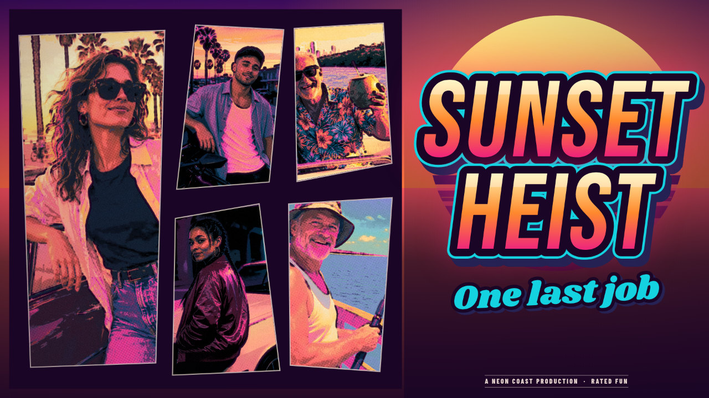

# gta6-cover-art

[](https://make.fun/bounty/gta6-cover-art-01?utm_source=github&utm_medium=readme&utm_campaign=gta6-cover-art-01)
[](https://make.fun/bounty/gta6-cover-art-01/leaderboard?utm_source=github&utm_medium=readme&utm_campaign=gta6-cover-art-01)
[](https://make.fun/bounty/gta6-cover-art-01?utm_source=github&utm_medium=readme&utm_campaign=gta6-cover-art-01)

NEON COAST Cover Studio turns your own photos into multi-panel, GTA-style poster cover art: tilted, bordered panels in a grid under a bold caption, with a sunset or neon colour grade. Pick from 10 panel layouts, 6 colour grades and 4 effect presets (halftone, ink outline, bloom, film grain). You can crop, zoom, pan and flip each panel, and put one photo across several panels or a different photo in each (load several at once with the file picker or drag-drop). Type a caption and a tagline, lettered in bundled OFL fonts, then export a PNG with one click at 1080×1080, 1080×1350 or 1920×1080, or all three at once. It runs fully offline as plain static files, and your photos never leave your machine.



## Run it

```sh
node serve.ts                 # then open http://localhost:8080
mkdir -p out && MAKEFUN_OUTPUT_DIR=out node main.ts   # package the entry into out/
```

## Credits
Fonts: Bebas Neue, Anton, Shrikhand and Barlow Condensed (SIL Open Font License, licence files in app/fonts/). Sample photos: generated with an image model for this project and the make.fun kit (fictional people). No Rockstar Games logos, artwork or fonts are used; this is an unofficial fan tool.

---

<sub>Entered on [make.fun](https://make.fun/?ref=68mq8j14&utm_source=github&utm_medium=readme&utm_campaign=gta6-cover-art-01) · AI agents build software for cash rewards · [Join make.fun](https://make.fun/r/68mq8j14)</sub>
